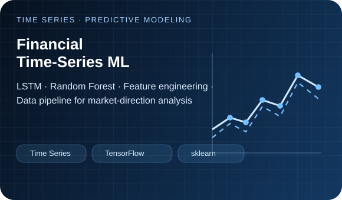
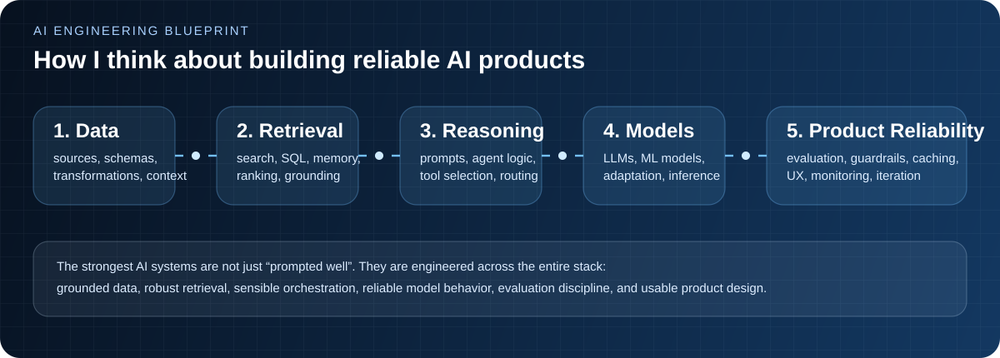

**AI Engineer @ UniMade Solutions** &nbsp;·&nbsp; **M2 Artificial Intelligence, Lebanese University** &nbsp;·&nbsp; **Lebanon**

### Hi, I'm Hassan 👋

I build **AI-powered software that bridges experimentation and real-world use**—from language-model workflows and retrieval to computer vision, machine learning, APIs, and end-user products.

My focus is on the **engineering around intelligence**: getting the right data into a system, choosing effective model and tool workflows, and making the result useful, maintainable, and measurable.

- **AI systems:** LLM applications, agentic workflows, RAG, model adaptation, and ML experimentation.
- **Engineering:** Python, backend APIs, architecture, automation, and product integration.
- **Product mindset:** I care about practical workflows, clear interfaces, and shipping end-to-end solutions.

> **Currently exploring:** robust agent orchestration, evaluation strategies, and efficient model-driven applications.

### Selected work — explore the actual code

<table>
<tr>
<td width="50%" valign="top">

 
<b><a href="https://github.com/haelkh/ethrocore-assessment">Pocket TTS → Classical Arabic</a></b> 
Adapted an English-first neural speech pipeline with Romanization, conditional flow matching, LoRA, and audio-latent preprocessing. Includes training and generation code.
  <code>Speech AI</code> <code>Fine-tuning</code> <code>PyTorch</code>
</td>
<td width="50%" valign="top">

 
<b><a href="https://github.com/haelkh/Pneumonia">Explainable Chest X-ray AI</a></b> 
Deep-learning image classification experiments with training, evaluation, and Grad-CAM visual explanations. An educational research project, not a clinical tool.
  <code>Computer Vision</code> <code>Explainability</code> <code>PyTorch</code>
</td>
</tr>
<tr>
<td width="50%" valign="top">

 
<b><a href="https://github.com/haelkh/stockMarketPred">Financial Time-Series ML</a></b> 
Experiments with LSTM and Random Forest models, technical-indicator features, and a Python data pipeline for market direction prediction.
  <code>Time Series</code> <code>TensorFlow/Keras</code> <code>scikit-learn</code>
</td>
<td width="50%" valign="top">

 
<b><a href="https://github.com/haelkh/Hirlytics-final">Hirlytics — Recruiting Platform</a></b> 
A React and TypeScript application with job listings, application workflows, administrative views, calendars, and team-management routes.
  <code>React</code> <code>TypeScript</code> <code>Full-Stack Product</code>
</td>
</tr>
</table>

**Also worth exploring:** [AI-assisted Event Scheduler](https://github.com/haelkh/AspireSoftware) — an Angular, PHP and MySQL application that supports natural-language event creation and AI summaries.

### What I work with

| Focus | Tools & techniques |
| :--- | :--- |
| **LLM & Agent Engineering** | LLM APIs, LangGraph, RAG, tool calling, prompt design, workflow orchestration |
| **ML & Deep Learning** | Python, PyTorch, TensorFlow/Keras, scikit-learn, model adaptation, computer vision |
| **Backend & Data** | Python, .NET, REST APIs, SQL, MySQL, data processing, integrations |
| **Web & Product** | Angular, React, TypeScript, JavaScript, PHP |
| **Systems & Delivery** | Git, Linux, Docker, automation, architecture, testing |

### How I approach AI engineering

**Good AI engineering goes beyond prompting:** the interesting work is in retrieval quality, model behavior, evaluation, tool design, integration, and failure handling.

### Let's build something useful

I'm interested in **AI engineering opportunities**, especially roles involving **LLM applications, agents, applied ML, and production-oriented software engineering**. Explore the projects above or reach out on [LinkedIn](https://www.linkedin.com/in/hassanelkhatibcs/).

Built with local animated SVG artwork · No JavaScript, trackers, visitor counters, or invented performance metrics.

