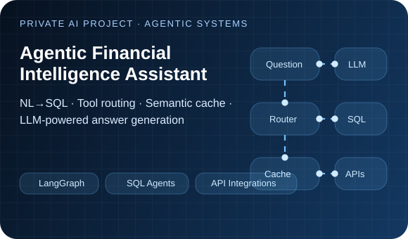

**AI Engineer @ UniMade Solutions** &nbsp;·&nbsp; **M2 Artificial Intelligence, Lebanese University** &nbsp;·&nbsp; **Lebanon**

## Hi, I'm Hassan 👋

I build **serious AI systems**: LLM applications, agentic workflows, retrieval pipelines, model adaptation, machine learning systems, APIs, and end-user products.

What matters to me is not just using a model — it is **engineering the full intelligence loop**:
**data → retrieval → reasoning → tooling → evaluation → product value**.

### What I bring

- **LLM & Agent Engineering:** agentic workflows, RAG, tool-calling systems, prompt design, structured outputs, routing, and orchestration.
- **Applied ML:** model adaptation, time-series prediction, speech and vision experimentation, evaluation, and explainability.
- **Backend & Product Delivery:** Python, APIs, system design, integrations, and turning experiments into usable software.
- **Execution mindset:** I like building end-to-end systems that are practical, measurable, and usable by real people.

> **Current focus:** production-minded AI systems, reliable agent behavior, evaluation strategy, and efficient model-driven software.

## Selected AI engineering work

Published projects link to source code. Private work is presented as a **technical case study** without exposing proprietary implementation details.

<table>
<tr>
<td width="50%" valign="top">

 
<b><a href="https://github.com/haelkh/ethrocore-assessment">Pocket TTS → Classical Arabic</a></b> 
Adapted an English-first neural speech pipeline into a Classical Arabic synthesis workflow using Romanization, conditional flow matching, LoRA, and audio-latent preprocessing.
  <code>Speech AI</code> <code>Fine-tuning</code> <code>PyTorch</code>
</td>
<td width="50%" valign="top">

 
<b><a href="https://github.com/haelkh/Pneumonia">Explainable Chest X-ray AI</a></b> 
Built a computer-vision workflow for pneumonia classification with training, evaluation, and Grad-CAM visual explanations to inspect model behavior.
  <code>Computer Vision</code> <code>Explainability</code> <code>PyTorch</code>
</td>
</tr>
<tr>
<td width="50%" valign="top">

 
<b><a href="https://github.com/haelkh/stockMarketPred">Financial Time-Series ML</a></b> 
Explored market-direction prediction with LSTM and Random Forest models, technical-indicator feature engineering, and a Python data pipeline.
  <code>Time Series</code> <code>TensorFlow/Keras</code> <code>scikit-learn</code>
</td>
<td width="50%" valign="top">

 
<b>Agentic Financial Intelligence Assistant</b> · <em>Private AI project</em> 
Architected an LLM-powered financial assistant that connects natural-language questions to structured data and API tools through agentic workflows. Focus areas include NL→SQL, routing, semantic caching, and production-oriented answer generation.
  <code>LangGraph</code> <code>SQL Agents</code> <code>API Integrations</code>
</td>
</tr>
</table>

**Also worth exploring:** [AI-assisted Event Scheduler](https://github.com/haelkh/AspireSoftware) — an Angular, PHP, and MySQL product with AI-supported event creation and summarization.

## AI engineering blueprint

**My engineering approach:** high-quality AI products come from the interaction between **data quality, retrieval quality, model behavior, tool design, evaluation discipline, and user-facing delivery**.

## Technical toolkit

| Focus area | Tools & techniques |
| :--- | :--- |
| **LLM & Agent Systems** | LLM APIs, LangGraph, RAG, retrieval pipelines, tool use, prompt engineering, structured outputs |
| **ML & Deep Learning** | Python, PyTorch, TensorFlow/Keras, scikit-learn, model adaptation, experimentation, explainability |
| **Backend & Data** | Python, .NET, REST APIs, SQL, MySQL, data processing, integrations, business logic |
| **Web & Product** | Angular, React, TypeScript, JavaScript, PHP |
| **Systems & Delivery** | Git, Linux, Docker, automation, testing, architecture |

## What recruiters should know

- I enjoy building **AI systems that do real work**, not just isolated notebooks.
- I am strongest where **software engineering and intelligent systems meet**.
- I care about **practicality, reliability, integration, and end-to-end execution**.

## Let’s connect

I’m interested in **AI engineering opportunities**, especially roles involving **LLM applications, agents, applied ML, backend engineering, and production AI systems**.

Built with custom animated SVG artwork · no fake metrics, visitor counters, or inflated claims.

